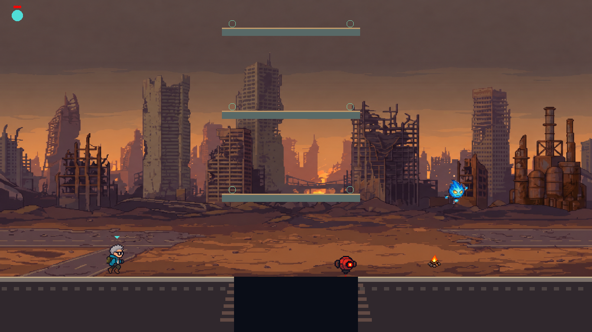
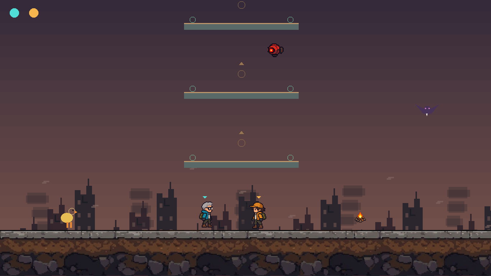

# JUNTOS · TOGETHER

**A ruined world. A tower to build. A journey to share.**

A game jam platformer about collecting, building, and reaching the top together.

### [⬇ Download for Windows](https://github.com/natsouzax/game_jam/releases/latest/download/JUNTOS-Windows.zip)

[How to play](#how-to-play) · [Controls](#controls) · [For developers](#for-developers) · [Credits](#credits)

## The game

**JUNTOS (TOGETHER)** is a platformer made for a game jam. Collect falling materials, place blocks, and build a route up a tower while dealing with enemies and meteors.

Play on your own with either character, or team up with someone beside you in **local two-player co-op**. In co-op, reaching the top is a shared goal: both active players need to make it.

- **Build your own path:** each player collects materials and spends them to place blocks.
- **Climb and survive:** jump onto enemies, dodge hazards, and use checkpoints along the way.
- **Share the journey:** cooperate on the same screen and keyboard.
- **Explore the story:** an opening introduces the ruined world and the mission ahead.

## Download & play

**You do not need GameMaker or the source code to play.**

1. **[Download JUNTOS-Windows.zip](https://github.com/natsouzax/game_jam/releases/latest/download/JUNTOS-Windows.zip).**
2. Right-click the downloaded ZIP and select **Extract All**.
3. Open the extracted **JUNTOS-Windows** folder.
4. Double-click **Play.cmd** to launch the game.

**Requirements:** Windows 64-bit with DirectX 11.

> Keep all extracted files together. `TOGETHER.exe` needs `data.win` and the included opening video. Use `Play.cmd` to start it with the correct game data, and extract the ZIP before playing.

[View releases and download assets →](https://github.com/natsouzax/game_jam/releases)

## How to play

Choose **solo** or **co-op** in the menu. In solo mode, choose your character and confirm again.

Collect materials by touching them, then build in the direction your character is facing. Each block costs **one material** from that player's own inventory. Jump onto enemies to defeat them and use the green platforms as checkpoints.

Watch out for meteors: they can destroy the blocks you build. Reach the top with every active player and continue to the final room.

## Controls

| Action | Solo / Player 1 | Player 2 |
| :--- | :---: | :---: |
| Move | A / D | ← / → |
| Jump | W | ↑ |
| Build / break | E | Enter |
| Charge dash | Q | Right Shift |
| Pause | Esc / P | Esc / P |
| Toggle audio | M | M |
| Toggle fullscreen | F11 | F11 |

To break a built block, stand on it and press the build key **twice quickly**.

**Menu:** A/D or ←/→ to select, E/Enter to confirm, and S/↓ to return from character selection. E/Enter also skips the opening.

**Controller support:** the first connected controller controls Player 2 in co-op or the selected character in solo. Use the left stick/D-pad to move, A/Cross to jump, X/Square to build, and B/Circle to charge dash. Physical controller compatibility still needs testing; see the [controller notes](docs/CONTROLLER_SUPPORT.md).

## A look inside

*Gameplay captures from the repository's test sessions.*

## For developers

Built with **GameMaker** and **GML**.

Open [`gameJam.yyp`](gameJam.yyp) in GameMaker to explore or run the project. The playable Windows download is packaged from the existing preview in `delivery/preview_opening_combat/`; it is not a fresh compilation of the current source.

| Path | Contents |
| :--- | :--- |
| `objects/` | Game objects and events |
| `scripts/` | Gameplay, controls, presentation, and test logic |
| `rooms/` | Game rooms |
| `sprites/`, `sounds/`, `shaders/` | Visual and audio resources |
| `art/` | Art references and production notes |
| `docs/` | Technical documentation, credits, and testing notes |
| `delivery/` | Existing Windows preview and jam delivery material |
| `tools/` | Build and production utilities |

The [Windows packaging workflow](.github/workflows/publish-windows.yml) bundles the executable with its required files and publishes a ZIP in Releases. It can also be run manually through the repository's Actions tab.

## Credits

Created during the game jam by **Natan, Guilherme, Luiz, Emmanuel, Vanessa, and Vitally**.

Some artwork and opening-video imagery were generated with AI. Scene narration uses synthesized speech, and music and sound effects were generated by script. See the [art and source notes](delivery/ART_AND_SOURCES.md) for details.

## Preview status & feedback

This is a **game jam preview**. The repository documents Runner-based checks and manual play sessions; physical controller support, two-player keyboard ghosting, and compatibility on another PC still need human verification.

Found a bug or have an idea? [Open an issue](https://github.com/natsouzax/game_jam/issues) and include what happened, how to reproduce it, and your Windows version.

---

**Build a path. Bring someone with you.**

[Download & play](https://github.com/natsouzax/game_jam/releases/latest/download/JUNTOS-Windows.zip)

